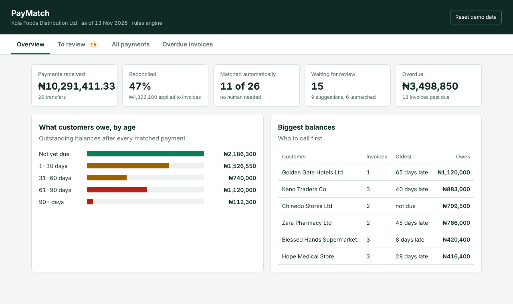
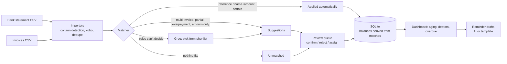

# PayMatch 💸

**Bank-transfer reconciliation for Nigerian businesses. PayMatch reads your bank statement and invoice list, works out which customer paid which invoice, sends only the unclear payments to a person, and tells you who to chase. It won't chase anyone whose payment is already in.**

[](https://github.com/MartinezYT/paymatch/actions/workflows/ci.yml)
  

🔗 **Live demo:** https://paymatch-nhk8.onrender.com · 📖 **API docs:** https://paymatch-nhk8.onrender.com/docs



---

## The problem

Most B2B payments in Nigeria arrive by bank transfer, and the statement says things like:

```
NIP TRF FRM ADEBAYO OLUWASEUN/FBN          ₦1,250,000
USSD/ZEN/BLESSED HANDS SUPERMKT              ₦343,400
TRANSFER                                     ₦150,000
```

Nothing there says "invoice 1006". The payer is often the owner's personal account, the name is abbreviated or misspelt, one transfer covers two invoices, or it's a part payment. So someone in accounts spends hours every week matching payments by hand. Mistakes are expensive both ways: a missed match means **chasing a customer who already paid**, and a wrong match means **an unpaid invoice that never gets chased**.

## What PayMatch does

1. **Imports** a bank statement CSV in whatever layout your bank exports. Columns are found by name, account-info lines at the top are skipped, debits are ignored, and re-imports don't duplicate. It also imports your invoice list, with customer aliases (owners, staff, other spellings).
2. **Matches** each payment with rules, from most to least certain:

   | Situation | Example narration | Result |
   |---|---|---|
   | Invoice number quoted, amount exact | `CHINEDU STORES/INV-1001` | applied automatically |
   | Clear payer name + exact amount | `MOBILE TRF FROM MAMA NKECHI PROV` | applied automatically |
   | Owner's personal account | `TRANSFER FROM OLUWASEUN ADEBAYO` | applied automatically (via alias) |
   | One transfer, several invoices | `USSD/ZEN/BLESSED HANDS SUPERMKT` ₦343,400 | suggested: 1008 + 1009 |
   | Part payment | `ZARA PHARMACY LTD PART PAYMT` | suggested: oldest debt first |
   | Overpayment | `IBRAHIM SANI` ₦1,000,000 | suggested, with unapplied credit |
   | Unknown payer, unique amount | `TRF FRM AMARACHI OKORO` | suggested, flagged as amount-only |
   | No name, amount fits two customers | `TRANSFER` ₦150,000 | **left for a person, never guessed** |

3. **Asks the AI only when the rules can't decide.** The model (Groq's free `openai/gpt-oss-120b`) gets the narration and a shortlist of open invoices, and must answer through a strict function call. It can only pick invoices from the shortlist, it can't mix customers, and its answer is never applied without a person confirming. The code, not the AI, decides how much goes to each invoice.
4. **Review queue.** Confirm, reject, or assign the payment to the right invoice yourself. When a person confirms a match, the invoice balances update.
5. **Reports.** Payments reconciled, aging buckets (not due / 1-30 / 31-60 / 61-90 / 90+ days), and biggest balances.
6. **Chasing.** Drafts reminder emails whose tone gets firmer the longer an invoice is overdue. It **refuses to chase** an invoice that already has a payment waiting for review.

## Design decisions

- **A wrong automatic match is worse than no match.** Automatic matching needs an invoice reference, or a strong name match that beats every other customer by a clear margin plus an exact amount. Everything else is a suggestion. The evaluation fails CI if any automatic match is wrong.
- **Money is integer kobo.** Floats can't represent amounts like 0.1 exactly, and reconciliation depends on amounts being exactly equal.
- **Balances are derived, never stored.** An invoice's paid amount is always calculated from automatic and confirmed matches, so it can't drift out of sync.
- **Certain matches first.** Matching runs in two passes, so a guess can't take an invoice that a later payment quotes by number.
- **Suggestions reserve invoices.** Two payments are never suggested for the same invoice. A pending suggestion also can't make an ambiguous amount look unique; a regression test covers the bug that first exposed this.
- **The public demo is safe.** It shares one database, so uploads are switched off there. Nobody can upload a real statement into a page others can see.

## Architecture



| Module | Job |
|---|---|
| `app/importers.py` | Bank and invoice CSVs, any column layout |
| `app/normalize.py` | Payer name from a narration, invoice references, fuzzy name scoring |
| `app/matcher.py` | The rules, the ledger, two-pass reconciliation, AI shortlist |
| `app/ai.py` | Forced function calls to Groq/Gemini; reminders with a template fallback |
| `app/service.py` | Import, review, reports, chasing |
| `app/store.py` | SQLite; paid amounts derived from matches |
| `app/main.py`, `app/dashboard.py` | API, auth, demo safety, dashboard |

## Evaluation

`sample/` is a realistic dataset: a Lagos food distributor with 12 customers, 36 invoices, and a 38-day statement in the layout Nigerian banks export, with 26 credits covering every situation above plus non-customer credits (POS settlement, interest, an own-account transfer, a reversal). `evals/labels.json` has the correct answer for every credit.

```bash
python -m evals.run_eval          # rules only
GROQ_API_KEY=... python -m evals.run_eval --ai
```

| Engine | Correct | Applied automatically | Wrong automatic matches |
|---|---|---|---|
| Rules | 26/26 | 11/26 (42%) | 0 |
| Rules + Groq `openai/gpt-oss-120b` (live deployment) | 26/26 | 11/26 (42%) | 0 |

On the live deployment (13 Nov 2026), the AI reviewed the 6 credits the rules couldn't place: a POS settlement, bank interest, an own-account transfer, a reversal, a non-customer and the bare `TRANSFER` that fits two customers. It **correctly declined all 6** and gave a checkable reason each time, for example *"Two open invoices match the amount (1016 and 1023), making it ambiguous"*. Its positive path (picking invoices for a payment the rules missed) is covered by tests with a fake model, but this dataset doesn't exercise it live.

The rules were written alongside this dataset, so treat the score as a check that every situation is handled as designed, not as a real-world accuracy figure. The meaningful numbers are the 0 wrong automatic matches and the CI guard that keeps it that way.

## Run it

```bash
pip install -r requirements-dev.txt
DEMO_MODE=true AS_OF_DATE=2026-11-13 uvicorn app.main:app --reload   # http://localhost:8000
pytest -q                                                              # 58 tests, offline
```

Use your own data: run without `DEMO_MODE`, set `API_KEY`, then

```bash
curl -H "X-API-Key: $API_KEY" -F file=@invoices.csv  localhost:8000/api/import/invoices
curl -H "X-API-Key: $API_KEY" -F file=@statement.csv localhost:8000/api/import/statement
```

Deploy free on Render: **New + → Blueprint →** this repo (`render.yaml`), then add your `GROQ_API_KEY`.

## Built with Claude Code

Built with [Claude Code](https://claude.com/claude-code) as a pair programmer; conventions in [`CLAUDE.md`](CLAUDE.md).

## Roadmap

- [ ] Pull statements automatically through open-banking APIs (Mono, Okra) instead of CSV
- [ ] Send reminders by email and WhatsApp straight from the dashboard
- [ ] Learn new customer aliases from confirmed matches
- [ ] Export reconciled payments to QuickBooks, Zoho Books or Sage

## License

MIT
